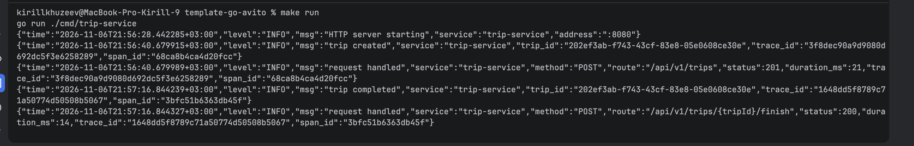
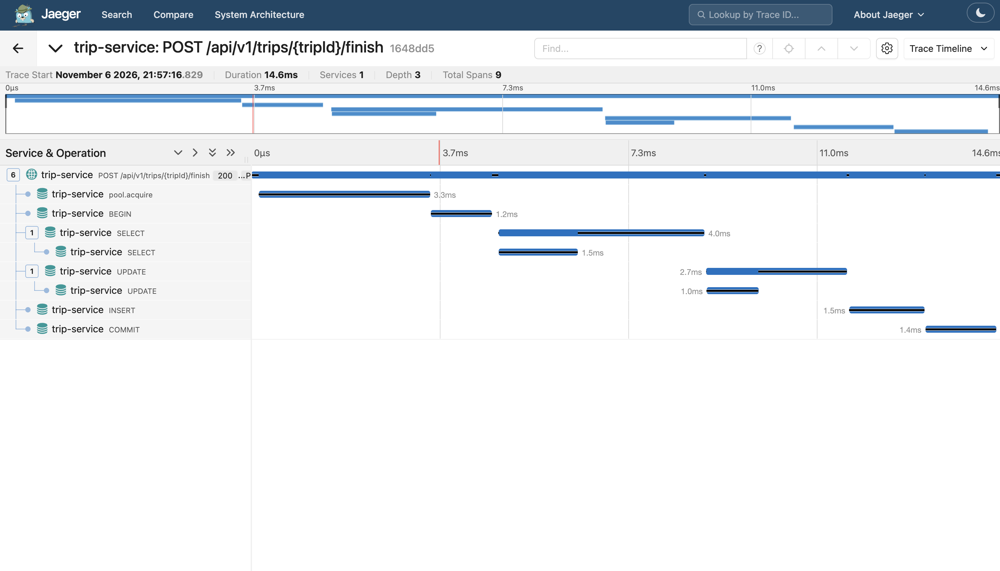
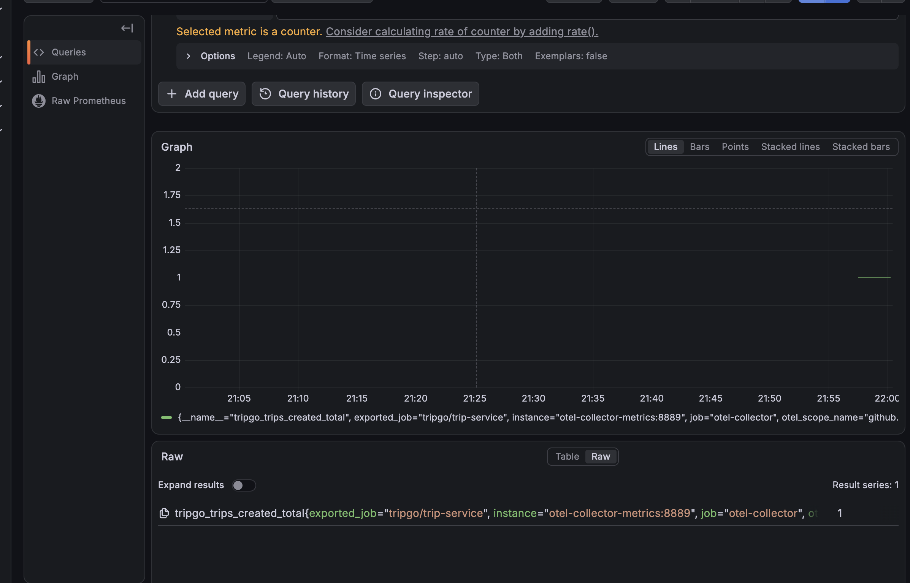
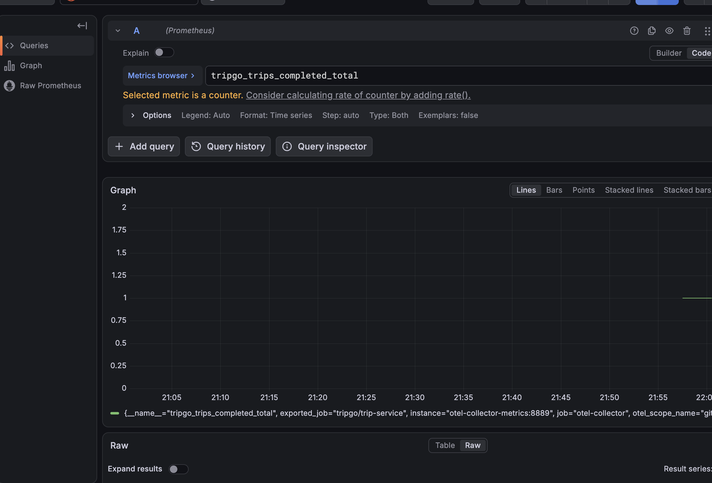
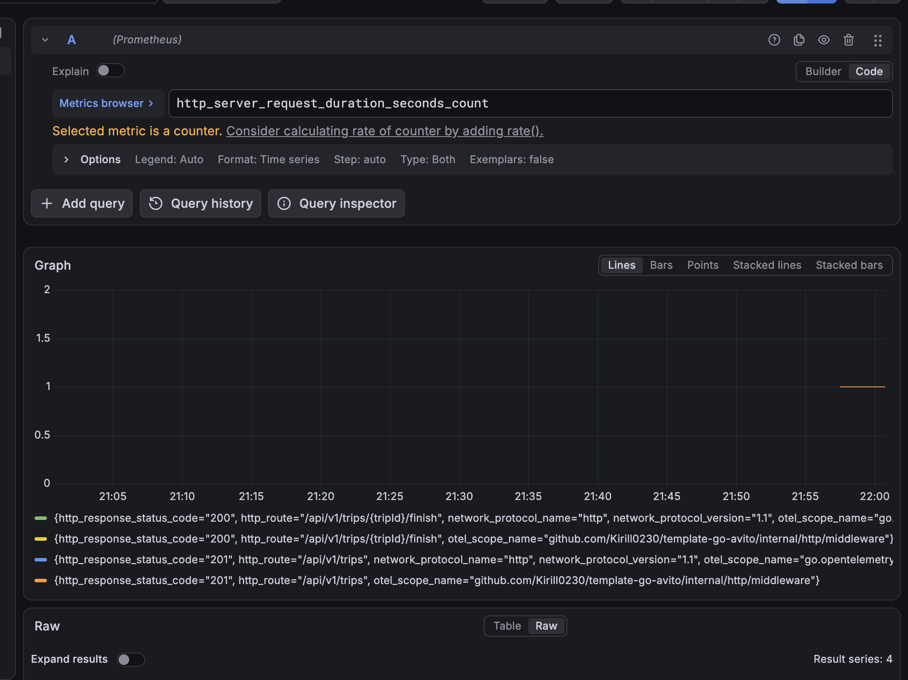
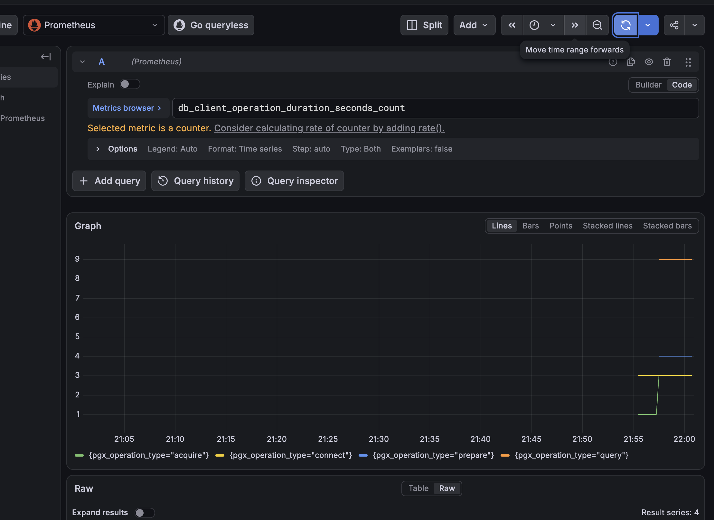

# Trip Service

Сервис создания, получения и завершения поездок. В лабораторной работе сервис разделён на слои, покрыт тестами и подключён к OpenTelemetry.

## Архитектура

```text
HTTP → usecase → domain
          ↑
     repository
```

- `cmd/trip-service` загружает конфигурацию и запускает приложение;
- `internal/container` создаёт и связывает зависимости;
- `internal/http` содержит handlers, middleware и преобразование ошибок в HTTP;
- `internal/usecase` реализует сценарии работы с поездками;
- `internal/domain` содержит бизнес-правила и переходы статусов;
- `internal/repository` реализует хранение данных в PostgreSQL;
- `internal/infra` инициализирует PostgreSQL, транзакции и OpenTelemetry.

Интерфейсы объявлены на стороне потребителя в `contract.go`. Домен не зависит от HTTP и PostgreSQL.

## Запуск

```bash
tripgoctl cluster start
tripgoctl environment start
tripgoctl connect
make migrate
make run
```

Переменные окружения описаны в `.env.example`. Актуальные адреса окружения выводит `tripgoctl connect`.

## Проверка

```bash
make lint
make test
make test-integration
```

Unit-тесты запускаются с race detector. Интеграционные тесты работают с PostgreSQL и проверяют сохранение данных и откат транзакции.

## Observability

Сервис отправляет телеметрию по OTLP:

- JSON-логи `slog` содержат `trace_id` и `span_id`;
- HTTP и PostgreSQL запросы представлены отдельными spans;
- собираются HTTP и DB метрики;
- бизнес-метрики считают созданные и завершённые поездки.

### Логи



### Трейс в Jaeger



### Метрики в Grafana

Созданные поездки:



Завершённые поездки:



HTTP-запросы:



Операции PostgreSQL:



## Мутационное тестирование

Пакеты `internal/domain` и `internal/usecase` проверены с помощью Gremlins.

| Запуск | Killed | Lived | Not covered | Покрытие мутаций |
|---|---:|---:|---:|---:|
| До дополнительного теста | 17 | 0 | 5 | 77,27% |
| После дополнительного теста | 22 | 0 | 0 | 100% |

После добавления теста повторного идемпотентного запроса все найденные мутации уничтожаются тестами. Отчёты сохранены в `docs/mutation`.
